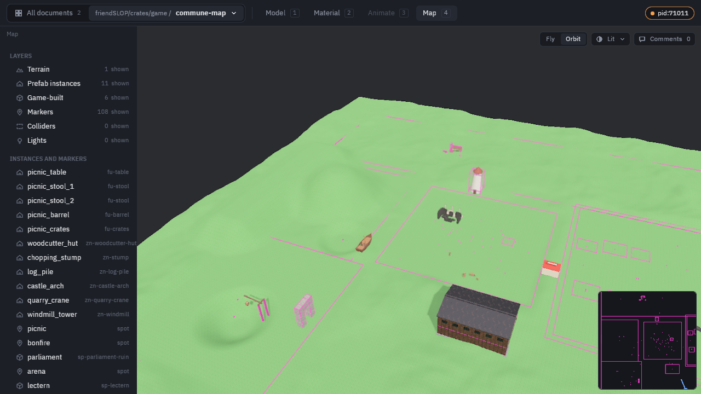

# modeler

A mesh modeling tool driven by an MCP server, with a live Bevy preview
window. Built standalone out of the friendSLOP workspace; no game code.



## Units

**1 unit = 1 meter**, everywhere: op sizes and positions, bounds, the
preview, saved prefabs and glTF exports (also meters, so they import at
true scale). Y is up and the ground is y = 0. Model at real-world size.

## Run

```sh
# Booleans use Manifold (C++): the first build needs git, cmake and a C++
# compiler, and clones the library from the network.
cargo run                # MCP server on stdio + preview window
cargo run -- --headless  # no window/render, for CI or remote agents
```

Point your agent's MCP config at the proxy, so every agent session shares
one server and one preview window:

```json
"modeler": {"type": "stdio", "command": "python3",
            "args": ["/path/to/modeler/mcp_driver.py", "--proxy"]}
```

The first session starts the shared daemon (windowed); later sessions join
it, whatever project they are in: one window shows every agent's work, its
document list groups the open documents by project, and a new agent
brings it to the front. A restart reopens only unsaved documents. Pointing the config at `target/debug/modeler` instead gives each session
its own server and window.

## Downloads

The rolling [`latest` release](https://github.com/cumsauce/modeler/releases/tag/latest)
has a build of `main` for every platform: the desktop app (preview window +
MCP server) for macOS (Apple silicon and Intel, also as an unsigned
`modeler.app`: right-click > Open the first time), Windows and Linux, plus
the headless Linux build for CI below.

## In CI (Linux, headless)

Every push to `main` builds a Linux x86_64 binary (no window, no GPU, no
audio) and publishes it as the rolling
[`latest`](https://github.com/cumsauce/modeler/releases/tag/latest) release.
To give a Claude Code run in another repo's workflow the `mcp__modeler__*`
tools, add the action before it:

```yaml
jobs:
  claude:
    runs-on: ubuntu-latest
    steps:
      - uses: actions/checkout@v4
      - uses: cumsauce/modeler@main        # installs it, writes .mcp.json
      - uses: anthropics/claude-code-action@v1
        with:
          anthropic_api_key: ${{ secrets.ANTHROPIC_API_KEY }}
          claude_args: --mcp-config .mcp.json --allowedTools "mcp__modeler__*"
```

The action adds `{"modeler": {"command": ..., "args": ["--headless",
"--project", <repo root>]}}` to `.mcp.json` (inputs: `release`, `mcp-config`,
`project`, `render`; output: `bin`); relative exports land in the project's
`assets/`. `--headless` runs every tool but the renders (`agent_views`,
`screenshot`). For those too, pass `render: true`: the action installs
Mesa's software Vulkan driver (lavapipe, CPU only, no GPU needed) and runs
`--offscreen`, the full renderer with no window. Renders take a few seconds
each on the CPU.

Anywhere else on Linux (a container, a cloud session), download the tarball
from the release and run `modeler --headless`, or for renders:

```sh
apt-get install -y libvulkan1 mesa-vulkan-drivers
modeler --offscreen
```

## What's inside

- **Primitives**: box, sphere, cylinder, cone, torus, capsule, plane,
  wedge, disc, washer; raw triangle meshes.
- **Op graph**: an ordered list of steps (primitive, extrude, revolve, sweep, hull, round, group, transform, boolean,
  radial/linear array, mirror, material) that derive the parts. Ops are
  upserted by output name, so re-issuing one is a parameter tweak, and
  the whole model re-derives. `mirror` bakes the reflection so it
  renders correctly.
- **History tree**: every edit snapshots the model into a tree with a
  cursor — undo/redo, jump anywhere, and editing after a jump branches
  instead of discarding.
- **Prefab catalog**: non-destructive saves (op graph + history tree +
  annotations; procedural geometry re-derives on load; atomic writes).
  In a game project (a `Cargo.toml` beside `assets/`, a `.modeler/` folder,
  or `--project <dir>`) everything lives in `<project>/.modeler/`, outside
  `assets/`, and relative exports land in `assets/`. Elsewhere it uses the
  shared `~/Library/Application Support/friendslop/modeler/`.
- **Senses for agents**: `verify` checks (closed meshes, bounds, grounded,
  stable), `inspect` (gaps/overlaps between parts, cross-sections, mass and
  tipping), and `agent_views` renders: several views tiled into one image,
  part-ID colouring, dimension overlays and before/after diffs.
- **Procedural PBR materials**: node graphs of 2D/3D SDFs, noise (value,
  gradient, worley), maths and colour, evaluated in parallel on the CPU and
  baked to base colour / roughness / metallic / normal / AO textures. Tileable
  (real-size tiles mapped by metric uvs) or object-space (3D fields on a
  per-part atlas). Their own history trees, a `materials/` library next to the
  prefabs, deterministic checks, and textured glTF export.
  `cargo run --example procedural_material` walks through it.
- **Annotations**: comments pinned to a part/face, typed in the preview
  window or via tools.

## Preview window controls

The window opens on All documents: every open document side by side,
grouped by project, labelled with the agent that last changed it, with an
agent feed beside them (click a tile to open it; `G` comes back). The top
bar switches documents (search with ⌘K) and modes: `1` Model, `2`
Material (the node graph with a lit preview), `3` Animate (a timeline;
Space plays), `4` Map (fly with WASD, a minimap). Left-drag orbits,
middle-drag pans, right-drag looks around and flies with WASD, scroll
zooms. Click a part to select it (its properties and comments open on the
right); `C` opens comments, and a click then pins a spot to comment on
(Enter commits, Esc cancels).
